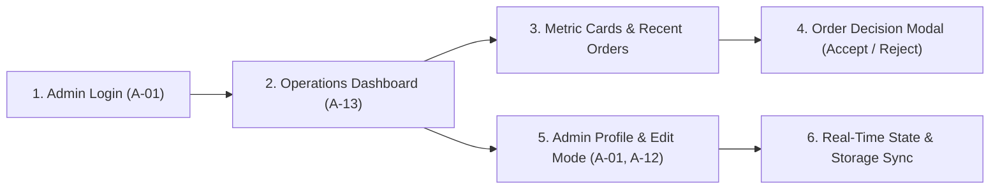

# HireD Admin Web Portal — System & Feature Overview
*(Project Master Index & Architecture Overview)*

This document provides a single high-level overview of the **HireD Admin Web Portal** features that are currently implemented in the codebase. It summarizes the active administrator workflow, core architectural decisions, and links to the detailed feature documentation.

---

## 1. System Context & Active Administrator Operations

HireD is an enterprise **B2B Corporate Mobility & Chauffeur Logistics Platform**. The Admin Web Portal serves as the primary operational command center for platform dispatchers and corporate administrators:



1. **Admin Authentication (PRD A-01):** Administrators log in with corporate credentials (`LoginPage.jsx`), receiving session persistence via `localStorage` (`hired_admin_user`) and immediate role-based access. Includes demo account quick-fill chips.
2. **Operations Dashboard (PRD A-13):** High-level operational overview (`DashboardPage.jsx`, `DashboardHeader.jsx`) showing real-time metrics, live calendar date badge, and platform controls.
3. **Operational Indicators:** Prominently displays high-priority counters for *Ongoing Trips* (navigates to trips) and *Pending Invoice Verification* (navigates to invoices).
4. **Recent Orders & Decision Modal:** Interactive data table (`RecentOrdersTable.jsx`) supporting search by keyword, status filter chips (`All`, `Pending`, `Ongoing`), dynamic date sorting, and an Order Details modal to accept ("Accept & Assign Trip") or reject orders.
5. **Admin Profile & Credential Management (PRD A-01, A-12):** Dedicated full-page profile canvas (`AdminProfilePage.jsx`) displaying administrator identity, one-click clipboard copying for phone/email, verification authority, and an interactive inline Edit Profile form with live validation.
6. **Application Shell & UI Controls:** Single Page Application shell (`AdminShell.jsx`) with a 68px collapsible mini rail sidebar (`Sidebar.jsx`), sticky topbar with admin identity pill (`Navbar.jsx`), dark/light theme switching (`ThemeContext.jsx`), and clean fallback views (`BlankPage.jsx`) for non-dashboard navigation links.

---

## 2. Feature & Page Documentation Index

| Screen Index | Feature Name | PRD Requirements | Implementation Status | Detailed Documentation |
| :--- | :--- | :---: | :---: | :--- |
| **Page 1** | **Admin Authentication & Login** | `A-01` | `[✓ Passed]` | [01_admin_authentication.md](01_admin_authentication.md) |
| **Page 2** | **Executive Dashboard & Overview** | `A-13` | `[✓ Passed]` | [02_admin_dashboard.md](02_admin_dashboard.md) |
| **Page 3** | **Admin Profile & Credential Management** | `A-01`, `A-12` | `[✓ Passed]` | [03_admin_profile.md](03_admin_profile.md) |

> [!NOTE]
> Only the 3 features listed above are currently implemented in the codebase. Other sidebar modules (`Company Directory`, `Orders Inbox`, `Ongoing Trips`, `Driver Onboarding`, `Admin Onboarding`, `Invoice Verification`, `Reports`) currently render placeholder views via `BlankPage.jsx` and will be documented as their feature branches are developed.

---

## 3. Technology Stack & Key Decisions

* **Framework:** React 18.3.1 with Vite 5.4.8 bundler for sub-second Hot Module Replacement (HMR).
* **Styling & Design System:** Custom Vanilla CSS with semantic design tokens (`var(--primary)`, `var(--surface)`, `var(--border)`, `var(--text-main)`). Zero external CSS frameworks (no Tailwind) to maintain bespoke corporate styling.
* **Iconography:** `lucide-react` for clean, consistent SVG iconography.
* **State Management & Contexts:**
  * `AuthContext`: Manages admin session lifecycle, `localStorage` persistence (`hired_admin_user`), rate limiting / failed attempts tracking, and real-time profile updates.
  * `ThemeContext`: Dynamic Dark & Light theme switching persisted via `localStorage` (`hired_admin_theme`).
* **Navigation Architecture:** Single Page Application (SPA) shell (`AdminShell.jsx`) with responsive layout, collapsible mini rail, and full-page canvas routing.
* **Branding:** Official HireD corporate palette centered on `#6A379F` (Deep Purple) with high-contrast accessibility across viewports.

---

## 4. Current State: UI with Local State Layer

> [!NOTE]
> All current portal features operate in **UI + Local Simulation mode**:
> - Real authentication validation, session persistence, input sanitization, and error handling are live and fully functional.
> - Pre-seeded administrator accounts (`admin1@hired.com`, `admin2@hired.com`, `inactive@hired.com`) support seamless testing of all administrative workflows.
> - Profile modifications immediately sync across the executive topbar, collapsible sidebar, and full-page profile views without requiring page reloads.
> - Order status decisions in the Recent Orders table update local component state in real time.

---

## 5. Verification & Quality Summary

* **Compilation & Linting:** Vite dev server runs with **0 errors, 0 warnings**.
* **Browser & Device Testing:** Tested and verified on desktop (1920x1080), tablet (768px), and mobile viewports (375px).
* **Test Case Coverage:** 100% of implemented test scenarios for Pages 1, 2, and 3 are documented and passed in this directory:
  * **Page 1 (Authentication):** 10 test scenarios verified in [01_admin_authentication.md](01_admin_authentication.md#4-testing--verification)
  * **Page 2 (Dashboard):** 8 test scenarios verified in [02_admin_dashboard.md](02_admin_dashboard.md#4-testing--verification)
  * **Page 3 (Profile):** 13 test scenarios verified in [03_admin_profile.md](03_admin_profile.md#4-testing--verification)

---

## 6. How to Run the Project

Navigate to the admin portal directory and run:

```bash
cd Trinity-X/admin-portal

# 1. Install dependencies
npm install

# 2. Run local development server (Vite)
npm run dev
# Portal opens on http://localhost:3001/

# 3. Build production bundle
npm run build
```
