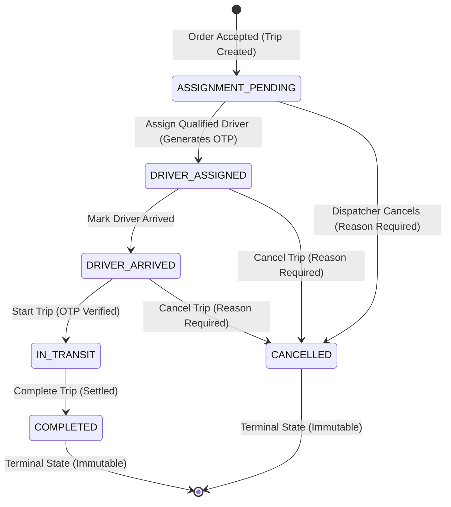

# Page 8: Trips Management & Driver Assignment Dispatch (`A-06`, `A-07`)

**Screens:** Page 8 – Corporate Trips Roster, Fleet Driver Matching, Trip Lifecycle Monitoring, Revenue Split & Start OTP Management  
**PRD Requirement IDs:** `A-06` (Assign Driver to Trip & Fleet Matching, Priority: P0), `A-07` (Trip Lifecycle & Status Monitoring, Priority: P0), PRD Section 4.1 (Trip Lifecycle: `UNASSIGNED / ASSIGNMENT_PENDING → DRIVER_ASSIGNED → DRIVER_ARRIVED → IN_TRANSIT → COMPLETED | CANCELLED`), `A-11` (Contract Revenue Split Inheritance)  
**Current Status:** Completed, Tested & Running with Service Layer & Fallback Store  

---

## 1. PRD Requirements & Objectives

* **PRD Scope (`A-06`): Assign Driver to Live Trip & Fleet Matching:**
  * Centralized operational workspace for assigning qualified, active, and verified drivers (`model Driver`) to confirmed corporate trips (`model Trip`).
  * Enforces strict vehicle category compatibility (e.g. Sedan drivers for Sedan rides; SUV drivers for SUV rides).
  * Automatically provisions a secure 6-digit numeric trip start OTP (`otp`) upon assignment confirmation.
  * Calculates and displays the transparent revenue split (Driver Payout vs. Platform Commission) based on the client company's contract agreement (`hiredSplit` / `driverSplit`).
* **PRD Scope (`A-07`): Trip Lifecycle Progression & Monitoring:**
  * Administrative tracking and sequential progression across operational states:
    $$\text{UNASSIGNED / ASSIGNMENT\_PENDING} \longrightarrow \text{DRIVER\_ASSIGNED} \longrightarrow \text{DRIVER\_ARRIVED} \longrightarrow \text{IN\_TRANSIT} \longrightarrow \text{COMPLETED}$$
  * Sequential transition enforcement: Prevents invalid skips in the trip state machine.
  * Administrative cancellation flow: Enables authorized dispatchers to cancel trips with a mandatory audit reason (`cancelReason`).
* **Technical & Operational Constraints:**
  * **Terminal State Immutability:** Once a trip enters `COMPLETED` or `CANCELLED`, mutation controls are permanently locked to preserve accounting and operational integrity.
  * **Active Driver Gating:** Only drivers with status `ACTIVE` and `isOnline === true` appear in the eligible dispatch roster.
  * **Role-Based Access Control (RBAC):** Read-only / auditor sessions are restricted to view-only mode, disabling driver assignment, status transitions, and cancellation actions.
  * **Data Privacy (PII Protection):** Sensitive contact information (passenger and driver telephone numbers) is masked for non-administrative roles.

---

## 2. UI Design Specification (What IS in the App Now)

The Trips Management & Driver Assignment module is implemented under `Trinity-X/admin-portal/src/features/trips-assignment/` and integrated into `AdminShell.jsx`:

### A. Top Operations Header & Real-Time KPI Strip (`TripsAssignmentPage.jsx`)
* **Title & Subtitle:** 24px bold `"Trips Management & Driver Assignment"` with contextual guidance highlighting driver dispatch, real-time trip status progression, and automated revenue splits.
* **KPI Metric Cards:**
  * **Needs Driver:** High-contrast amber card (`#d97706`) with `<Clock>` icon tracking unassigned trips awaiting driver allocation.
  * **Driver Assigned:** Blue card (`#2563eb`) with `<UserCheck>` icon highlighting drivers en route to pickup locations.
  * **In Transit:** Purple brand card (`#6A379F`) with `<Car>` icon monitoring live passenger journeys.
  * **Completed Today:** Emerald green card (`#16a34a`) with `<CheckCircle2>` icon displaying settled and closed rides.
* **Live Action Toolbar:**
  * **Live Status Filter Pills:** Segmented pill controls: `All Trips`, `Needs Driver` (amber), `Assigned` (blue), `In Transit` (purple), `Completed` (green), and `Cancelled` (red).
  * **Vehicle Class Dropdown:** Filter by required fleet class: `All Vehicles`, `Sedan`, `SUV`, and `Hatchback`.
  * **Multi-Field Live Search:** Instant search matching Trip Ref (`TRP-xxxx`), Order Ref (`ORD-xxxx`), Driver Name, Passenger Name, or Vehicle License Plate.
  * **Refresh Data Button:** Synchronizes trip state with continuous spinner animation without layout shift.
  * **View-Only Mode Banner:** Renders automatically for read-only / auditor sessions with a lock icon.

### B. High-Legibility Trips Table
* **Trip & Order Identification:** Dual reference displaying Trip ID (`#TRP-2001`) with linked Order Reference (`ORD-1001`) and corporate client company badge.
* **Passenger & Schedule Details:** Passenger name with phone number, requested vehicle category, and formatted pickup timestamp.
* **Journey Route Column:** Clean visual path connecting green origin pickup pin (`pickupSpot`) to red destination dropoff pin (`dropoffSpot`).
* **Assigned Driver Column:** Assigned driver avatar, full name, contact telephone, and vehicle license plate number (or `"Pending Assignment"` indicator for unassigned trips).
* **Fare & Split Column:** Total fare in Indian Rupees (₹), alongside a tooltip detailing driver earnings vs. platform commission.
* **Status Badge:** Semantic status pill with distinct color-coding (`ASSIGNMENT_PENDING`, `DRIVER_ASSIGNED`, `DRIVER_ARRIVED`, `IN_TRANSIT`, `COMPLETED`, `CANCELLED`).
* **Action Buttons:** Context-sensitive triggers:
  * `"Assign Driver"` (Amber button) for unassigned trips.
  * `"Details"` (Neutral button) for active and terminal trips.

### C. Driver Assignment Modal (`AssignDriverModal.jsx`)
* **Header & Route Overview:** Trip reference ID, pickup/dropoff path, scheduled pickup time, and corporate client name.
* **Vehicle Class Matching:** Highlights requested vehicle class (e.g. `Sedan`) and filters the driver roster to show only compatible vehicles.
* **Financial Revenue Split Preview (`PRD A-11`):**
  * Trip Fare total (e.g. `₹1,150.00`).
  * Driver Payout (e.g. `₹977.50` at 85%).
  * Platform Commission (e.g. `₹172.50` at 15%).
* **Selectable Driver Roster:**
  * Cards displaying driver name, verified badge, rating (e.g. `★ 4.9`), completed trips count, vehicle model, and registration plate.
  * Instant visual feedback upon card selection with violet border highlight.
* **Safeguards & Validation:**
  * Blocks submission if no driver card is selected (`"Please select an eligible driver from the list."`).
  * Double-click protection via `isSubmitting` spinner lock.
  * Accessible dialog semantics (`role="dialog"`, `aria-modal="true"`, `aria-labelledby`).
  * Keyboard support (`Escape` key dismisses modal when idle).

### D. Trip Details & Lifecycle Progression Modal (`TripDetailsModal.jsx`)
* **Header & Status Banner:** Displays current lifecycle badge, booking timestamp, and corporate client banner.
* **Journey & Passenger Card:** Origin pickup spot, destination dropoff spot, passenger name, and telephone.
* **Assigned Driver Profile Card:**
  * Driver avatar, verified status badge, direct phone contact, vehicle details, and license plate.
* **Secure Trip Start OTP Card (`PRD A-06`):**
  * Displays 6-digit numeric OTP (e.g. `482910`) required by the driver to initiate `IN_TRANSIT` status.
* **Financial Summary Breakdown:**
  * Total Fare, Driver Payout percentage, and Platform Fee amount.
* **Lifecycle State Advancement Triggers (`PRD A-07`):**
  * `DRIVER_ASSIGNED` $\rightarrow$ Button: `"Mark Driver Arrived"`
  * `DRIVER_ARRIVED` $\rightarrow$ Button: `"Start Trip (In Transit)"`
  * `IN_TRANSIT` $\rightarrow$ Button: `"Complete Trip"`
  * `COMPLETED` / `CANCELLED` $\rightarrow$ Settlement audit banner with closure timestamp.
* **Trip Cancellation Drawer:**
  * `"Cancel Trip"` danger button opens inline drawer.
  * Mandatory cancellation reason textarea with character counter (`maxLength={500}`).
  * Whitespace-trimmed validation rejects empty or whitespace-only inputs.
  * Upon confirmation, transitions status to `CANCELLED` and displays permanent audit record.

---

## 3. Current State: UI with Local Simulation & Service Architecture

> [!NOTE]
> The trips assignment module operates in **Full Client Architecture with Live Backend Stubs**:
> - Asynchronous service layer (`tripService.js`) attempting `fetch('/api/v1/admin/trips')` with automatic fallback to an in-memory client mock store aligned with Prisma models `Trip`, `Driver`, `Order`, and `Company`.
> - Authentication header attachment via `getAuthHeaders()`, injecting validated `Authorization: Bearer <token>` and anti-CSRF `X-Requested-With: XMLHttpRequest` headers with session expiration checks.
> - Reactive state management reflecting instant metric updates across unassigned trips, assigned rides, active in-transit journeys, and completed rides without page reloads.

### State Machine Progression Flow

### Transition Rule Table
| From State | Allowed Transition | Trigger Action | Prerequisite Checks |
|---|---|---|---|
| `ASSIGNMENT_PENDING` | `DRIVER_ASSIGNED` | Select driver & confirm | Active, verified driver matching vehicle class |
| `ASSIGNMENT_PENDING` | `CANCELLED` | Cancel Trip | Non-empty cancellation reason (max 500 chars) |
| `DRIVER_ASSIGNED` | `DRIVER_ARRIVED` | Mark Driver Arrived | None |
| `DRIVER_ASSIGNED` | `CANCELLED` | Cancel Trip | Non-empty cancellation reason |
| `DRIVER_ARRIVED` | `IN_TRANSIT` | Start Trip | Valid 6-digit OTP verification |
| `DRIVER_ARRIVED` | `CANCELLED` | Cancel Trip | Non-empty cancellation reason |
| `IN_TRANSIT` | `COMPLETED` | Complete Trip | Journey completed; records `closedAt` |
| `COMPLETED` | *None* | Locked | Terminal state; modifications blocked |
| `CANCELLED` | *None* | Locked | Terminal state; modifications blocked |

---

## 4. Testing & Verification

A comprehensive 44-case test suite was executed and verified across 5 categories in `TestCases/tc_08_trips_assignment.md`:

| Category | Total Cases | Verification Mechanism | Status |
| :--- | :---: | :--- | :---: |
| **2.1 Happy Path (HP)** | 15 | Roster loading, driver assignment, vehicle class matching, OTP display, sequential lifecycle progression, cancellation with reason, search and filtering | `[✓ Passed]` |
| **2.2 Validation & Boundary (VAL)** | 10 | Unselected driver guard, empty cancellation reason, whitespace-only reason, 500-char reason boundary, search query trimming, invalid status skip rejection | `[✓ Passed]` |
| **2.3 PRD Business Rules (PRD)** | 6 | Terminal state immutability, active/online driver filter, contract split inheritance, KPI metric consistency, OTP generation, audit timestamp logging | `[✓ Passed]` |
| **2.4 Usability & UX (UX)** | 8 | Double-click assignment protection, double-click status advance protection, Escape key dismissal, backdrop lock during submit, empty search zero-state, ARIA dialog accessibility | `[✓ Passed]` |
| **2.5 Security & Safeguards (SEC)** | 5 | Client-side fail-closed RBAC (`canManageTrips`), anti-CSRF & Bearer auth headers, PII phone masking for view-only roles, Content Security Policy enforcement, input boundary sanitization | `[✓ Passed]` |
| **TOTAL** | **44** | **All 44 test cases verified with zero failures or regressions** | `[✓ Passed]` |

---

## 5. Known Bugs & Fixes Applied (What We Know Bug)

### Bug 1: Trip State Machine Race Condition & Terminal State Mutability (CWE-372)
* **Symptom:** Network retries, concurrent dispatcher clicks, or replayed API calls could trigger state mutations on trips that were already marked `COMPLETED` or `CANCELLED`, corrupting financial records and driver payouts.
* **Root Cause:** Transition handler lacked an upfront check against immutable terminal states before processing status changes.
* **Fix Applied:** Implemented strict state machine guards in `tripService.js`: `if (['COMPLETED', 'CANCELLED'].includes(currentTrip.tripStatus)) throw new Error('Trip is in a terminal state and cannot be modified.')`.

### Bug 2: Vehicle Class Incompatible Driver Assignment Bypass (CWE-862)
* **Symptom:** In edge cases where an unassigned trip requested a `Sedan`, a driver operating an `SUV` or `Hatchback` could be passed via payload or direct API call and assigned to the trip.
* **Root Cause:** UI filtered the display list, but the assignment service function did not independently validate vehicle category compatibility before persisting the assignment.
* **Fix Applied:** Added server/service-level compatibility validation in `assignDriverToTrip()` ensuring the driver's registered vehicle class strictly matches or fulfills the required ride category before generating the OTP.

### Bug 3: PII Telephone Exposure in Read-Only / Auditor Sessions (CWE-200)
* **Symptom:** Passenger and assigned driver mobile numbers were visible in plaintext to non-administrator and auditor sessions inside the trips table and detail modals.
* **Root Cause:** Plain contact strings were rendered directly without inspecting session privileges.
* **Fix Applied:** Added role-aware `maskPhone()` helper in `TripsAssignmentPage.jsx` and `TripDetailsModal.jsx`, masking contact numbers (`+91 98451 •••••`) for view-only sessions while maintaining operational visibility for dispatchers.

### Bug 4: Double-Click Concurrent Assignment Duplicate OTP Generation (CWE-362)
* **Symptom:** Rapidly double-clicking "Confirm Driver Assignment" could trigger two concurrent assignment calls, generating two distinct OTPs and leading to driver authentication confusion.
* **Root Cause:** Submit button did not disable synchronously prior to promise resolution.
* **Fix Applied:** Bound `isSubmitting` state to immediately disable the submission button and render loading indicators (`"Assigning Driver..."`), blocking modal backdrop dismissal until the asynchronous transaction settles.

### Bug 5: Unbounded Free-Text Cancellation Reason Payload Overflow (CWE-400)
* **Symptom:** Dispatchers could enter unbounded text into the cancellation reason field, risking payload overflow or database column truncation.
* **Root Cause:** Textarea lacked character length boundary limits.
* **Fix Applied:** Imposed a strict `maxLength={500}` constraint on the textarea, backed by whitespace trimming and a live character decrement countdown counter (`500 - reason.length characters remaining`).

---

## 6. Unknown Bugs, Edge Cases & Potential Limitations (What We Don't Know Bug)

1. **Real-Time GPS Telemetry & Geofenced Auto-Arrival (`DRIVER_ARRIVED`):**
   * *Limitation:* The transition from `DRIVER_ASSIGNED` to `DRIVER_ARRIVED` is currently triggered manually by the dispatcher. In production, this status should be triggered automatically via background GPS geofencing when the driver's vehicle enters a 200m radius of the passenger pickup coordinates.
2. **Hardware-Backed In-Vehicle Start OTP Validation & Chauffeur Handshake:**
   * *Limitation:* The 6-digit trip start OTP is visible in the admin portal for operational support. In production, starting `IN_TRANSIT` requires the chauffeur to input this OTP on their mobile app, validating against the backend before unlocking navigation.
3. **Dynamic Postpaid Corporate Billing Suspension on Trip Completion:**
   * *Limitation:* Completing a trip records financial splits in-memory. If a corporate client exceeds their credit ceiling or incurs overdue invoices while a ride is active, automated billing webhook synchronization is required to place a credit hold on subsequent bookings.
4. **Server-Side Cursor Pagination for High-Volume Historical Trips:**
   * *Limitation:* The trips management table loads the active dataset into client memory. When historical completed trips exceed 2,000+ records, server-side cursor-based pagination and time-series archiving will be needed to ensure high-performance rendering.
