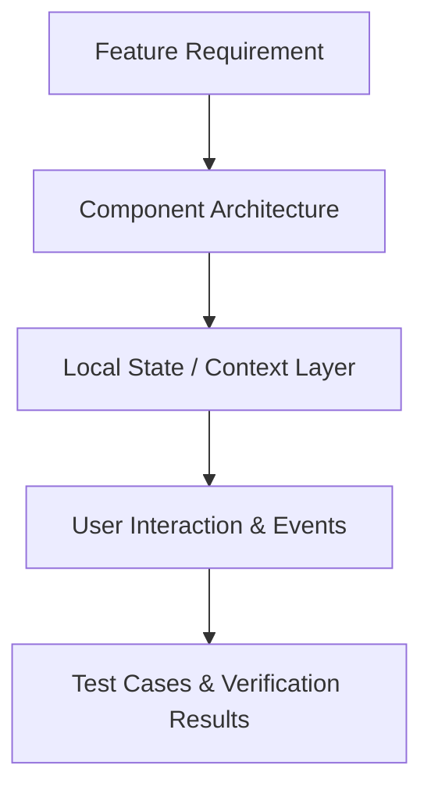

# Feature Documentation & Test Cases Directory (`admin-docs/`)

Welcome to the central feature documentation and test cases repository for the **HireD Admin Portal**.

---

## 📌 Documentation Philosophy

Every feature currently implemented in the Admin Portal maintains its own dedicated documentation file inside this directory, adhering strictly to the following core principles:

1. **Write for Humans First:** Plain, active voice, present tense, and jargon-free explanations.
2. **Strict Code Truthfulness:** Only features and components that are actually implemented in the codebase are documented. No unbuilt or phantom features.
3. **Prevent Duplication (DRY):** Each feature document serves as the single source of truth for its domain logic, state management, and UI controls.
4. **Incorporate Visual Aids:** Complex workflows and data interactions are modeled using standard Mermaid diagrams.
5. **Detailed Test Case Matrix:** Every document contains a complete table of verified test cases, verification mechanisms, and pass/fail statuses.

---

## 📂 Active Feature Documentation Structure

```text
admin-docs/
├── README.md                          # Documentation overview & style guidelines
├── 00_admin_portal_overview.md        # Master index & system architecture overview
├── 01_admin_authentication.md         # Page 1: Admin login & session management (A-01)
├── 02_admin_dashboard.md              # Page 2: Operations dashboard & key metrics (A-13)
└── 03_admin_profile.md                # Page 3: Admin profile & credential management (A-01, A-12)
```

> [!NOTE]
> This folder strictly contains documentation for code and features that have been completed, verified, and tested. Additional documentation will be added as upcoming feature branches are developed.

---

## 🎨 Diagram Standard Example



---

*This directory is updated incrementally alongside each feature branch development.*
