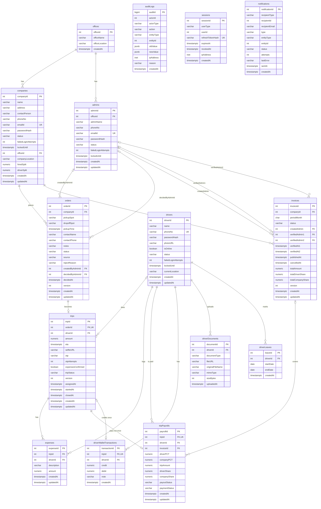

# HIRED BUILDATHON

# HireD Database Design

**Phase 1 MVP: tables, relationships, rules and design decisions**


|                      |                                               |
| -------------------- | --------------------------------------------- |
| **Team**             | Trinity X                                     |
| **Product**          | HireD (Admin Portal, B2B Portal, Driver App)  |
| **Based on**         | HireD PRD v0.2 and HireD Technical Guidelines |
| **Database**         | PostgreSQL 17                                 |
| **ORM / migrations** | Prisma                                        |
| **Document version** | 1.0                                           |
| **Date**             | 03 Oct 2026                                   |

---

## Contents

1. Purpose and scope
2. Overview of the tables
3. Conventions
4. ER diagram
5. Tables and columns
6. Relationships and cardinality
7. Constraints and business rules
8. Status values
9. Indexes
10. Data access and security
11. Audit trail
12. Reports and the Trip Report
13. Normalization
14. Important design decisions
15. Migration strategy
16. Open points
17. Change log

---

## 1. Purpose and scope

This document describes the database for HireD Phase 1. HireD supplies drivers to B2B partner companies.

Today the process runs by hand. The new system covers the full flow: **order → trip → driver payout → month-end invoice**.

The database serves three applications through one backend:

- **Admin Portal (web):** orders, trips, drivers, companies, payroll, invoices and reports.
- **B2B Portal (web):** partners place orders, follow trips, and see reports and verified invoices.
- **Driver App (mobile):** onboarding documents, trips, expenses, OTP trip close and wallet.

The design follows the PRD data model (section 6). It adds the supporting tables the PRD needs: offices, admins, driver documents, driver leave calendar, sessions, notifications and audit log.

---

## 2. Overview of the tables

The database has **15 tables in 7 groups**.


| Group                            | Tables                                           |
| -------------------------------- | ------------------------------------------------ |
| 1. Offices and partner companies | offices, companies                               |
| 2. Orders                        | orders                                           |
| 3. Trips                         | trips, expenses                                  |
| 4. Money                         | tripPayrolls, driverWalletTransactions, invoices |
| 5. Drivers                       | drivers, driverDocuments, driverLeaves           |
| 6. Admins                        | admins                                           |
| 7. System                        | auditLogs, sessions, notifications               |

The main flow in one line: a company places an order → the admin accepts it and it becomes a trip → a driver closes the trip with the OTP → the system writes one tripPayrolls row and one wallet credit → at month end the payroll rows are grouped into one invoice → two admins approve it → the partner can see it.

---

## 3. Conventions

### Names

- This document and the ER diagram use **camelCase**, e.g. `companyId`, `tripPayrolls`. This matches the names in our backend code.
- **In PostgreSQL the same names are created in snake_case**, e.g. `company_id`, `trip_payrolls`. PostgreSQL turns every name without quotes into lowercase, so `companyId` would silently become `companyid`. snake_case avoids quoting every name in every query. It also follows the naming the Technical Guidelines recommend (section 10).
- Prisma maps each snake_case column to its camelCase name with `@map`. The rule is mechanical: put `_` before each capital letter and use lowercase. Example: `verifiedAdmin1` → `verified_admin1`.
- **Table names are plural**: `companies`, `trips`, `auditLogs`.
- **Primary keys** are named `<entity>Id`, where the entity is the thing one row stands for: `companies.companyId`, `tripPayrolls.payrollId`, `driverLeaves.leaveId`.
- **Columns that record when something happened end in `At`**: `createdAt`, `closedAt`, `verifiedAt1`. Two columns hold a planned time, not an event, and keep their PRD names: `orders.pickupTime` (the requested pickup) and `trips.eta` (the estimate).

### Keys

- Primary keys are `INTEGER GENERATED ALWAYS AS IDENTITY` (PostgreSQL creates the number). `auditLogs` uses `BIGINT`, because it grows fastest.
- **Foreign keys** have the same name as the primary key they point to, e.g. `trips.driverId → drivers.driverId`. Exceptions, where one table points to `admins` more than once: `orders.createdByAdminId`, `orders.decidedByAdminId`, `invoices.createdAdmin`, `invoices.verifiedAdmin1`, `invoices.verifiedAdmin2`.
- All foreign keys use `ON DELETE RESTRICT`. Rows with history are never deleted. Users are switched off with a `status` column instead (section 10.2).

### PostgreSQL data types


| Type                 | Used for                                                                                          |
| -------------------- | ------------------------------------------------------------------------------------------------- |
| `INTEGER` / `BIGINT` | IDs, foreign keys and counters                                                                    |
| `VARCHAR(n)`         | Text with a maximum length                                                                        |
| `NUMERIC(12,2)`      | Money in rupees. Never`FLOAT` or `REAL`, so there are no rounding errors.                         |
| `NUMERIC(5,2)`       | Percentages, e.g. 30.00                                                                           |
| `TIMESTAMPTZ`        | Date and time with time zone. Stored in UTC. Shown and grouped in Asia/Kolkata (see section 7.5). |
| `DATE`               | A calendar day, with no time                                                                      |
| `CHAR(7)`            | A month in the format`YYYY-MM`                                                                    |
| `BOOLEAN`            | Yes / no values                                                                                   |
| `JSONB`              | Old and new values in the audit log                                                               |
| `INET`               | IP addresses                                                                                      |

### Other rules

- **Null column:** "No" means the column is `NOT NULL`. "Yes" means it can be empty.
- **Key column:** PK = primary key, FK = foreign key, UK = unique.
- **Passwords:** only a bcrypt hash is stored (`passwordHash`). The real password is never saved or logged.
- **Files:** documents and selfies are stored in private file storage. The database only keeps the storage path (`fileURL`, `selfieURL`, `photoURL`). Files are never public.
- **`updatedAt`:** the backend sets it on every update.
- **`version`:** tables that two admins may change at the same time (`orders`, `trips`, `invoices`) have a `version` number. See section 7.3.

---

# 4. ER diagram

The diagram is split into 7 groups: 1. Offices and partner companies, 2. Orders, 3. Trips, 4. Money: payout, wallet, invoice, 5. Drivers, 6. Admins, 7. System.



**Notes on the diagram:**

- `||--o{` means every child row has exactly one parent, and a parent has many children. `o|--o{` means the child's parent column can be empty. `||--o|` / `o|--o|` mean zero or one child per parent (the child column is UK).
- `auditLogs`, `sessions` and `notifications` link to users and records through a type column plus an id column (`actorType` + `actorId`, `userType` + `userId`, `recipientType` + `recipientId`). They have no foreign keys on purpose, because the target can be any of three user tables. They are drawn without lines.

---

## 5. Tables and columns

### 1. Offices and partner companies

#### offices

A HireD office or branch. Companies and admins belong to one office. An order's office is the office of its company.


| Column         | Type         | Key | Null | Notes           |
| -------------- | ------------ | --- | ---- | --------------- |
| officeId       | INTEGER      | PK  | No   | Identity.       |
| officeName     | VARCHAR(150) |     | No   |                 |
| officeLocation | VARCHAR(300) |     | Yes  |                 |
| createdAt      | TIMESTAMPTZ  |     | No   | Default`now()`. |

#### companies

A B2B partner company. It also holds the partner's portal login and the payout split.


| Column              | Type         | Key | Null | Notes                                                                                |
| ------------------- | ------------ | --- | ---- | ------------------------------------------------------------------------------------ |
| companyId           | INTEGER      | PK  | No   | Identity.                                                                            |
| name                | VARCHAR(150) |     | No   |                                                                                      |
| address             | VARCHAR(300) |     | Yes  |                                                                                      |
| contactPerson       | VARCHAR(150) |     | Yes  |                                                                                      |
| phoneNo             | VARCHAR(20)  |     | Yes  |                                                                                      |
| emailId             | VARCHAR(254) | UK  | No   | Login name for the B2B portal. Unique, compared in lowercase.                        |
| passwordHash        | VARCHAR(255) |     | No   | bcrypt hash. The real password is never stored.                                      |
| status              | VARCHAR(20)  |     | No   | ACTIVE, INACTIVE. Default ACTIVE. An INACTIVE company cannot log in or place orders. |
| failedLoginAttempts | INTEGER      |     | No   | Default 0. Reset to 0 on a good login.                                               |
| lockedUntil         | TIMESTAMPTZ  |     | Yes  | Set after 5 failed logins (15 minutes). Login is refused until this time.            |
| officeId            | INTEGER      | FK  | No   | → offices.officeId                                                                  |
| companyLocation     | VARCHAR(300) |     | Yes  |                                                                                      |
| hiredSplit          | NUMERIC(5,2) |     | No   | HireD's share in %, e.g. 70.00.                                                      |
| driverSplit         | NUMERIC(5,2) |     | No   | Driver's share in %, e.g. 30.00.                                                     |
| createdAt           | TIMESTAMPTZ  |     | No   | Default`now()`.                                                                      |
| updatedAt           | TIMESTAMPTZ  |     | No   | Default`now()`.                                                                      |

### 2. Orders

#### orders

A request for a trip. It comes from the B2B portal or is entered by an admin after a phone or WhatsApp request.


| Column           | Type          | Key | Null | Notes                                                                                           |
| ---------------- | ------------- | --- | ---- | ----------------------------------------------------------------------------------------------- |
| orderId          | INTEGER       | PK  | No   | Identity.                                                                                       |
| companyId        | INTEGER       | FK  | No   | → companies.companyId. The order's office is this company's office.                            |
| pickupSpot       | VARCHAR(300)  |     | No   |                                                                                                 |
| dropoffSpot      | VARCHAR(300)  |     | No   |                                                                                                 |
| pickupTime       | TIMESTAMPTZ   |     | No   | Requested pickup date and time.                                                                 |
| contactName      | VARCHAR(150)  |     | No   | Contact person for this trip (PRD B-02).                                                        |
| contactPhone     | VARCHAR(20)   |     | No   |                                                                                                 |
| notes            | VARCHAR(1000) |     | Yes  | Vehicle / service notes.                                                                        |
| status           | VARCHAR(20)   |     | No   | RECEIVED, ACCEPTED, REJECTED. Default RECEIVED.                                                 |
| source           | VARCHAR(10)   |     | No   | PORTAL or ADMIN.                                                                                |
| rejectReason     | VARCHAR(500)  |     | Yes  | Filled when the order is rejected. Sent in the rejection email.                                 |
| createdByAdminId | INTEGER       | FK  | Yes  | → admins.adminId. The admin who typed in a phone or WhatsApp order. Empty for a portal order.  |
| decidedByAdminId | INTEGER       | FK  | Yes  | → admins.adminId. The admin who accepted or rejected the order. Empty while RECEIVED.          |
| decidedAt        | TIMESTAMPTZ   |     | Yes  | When the order was accepted or rejected.                                                        |
| version          | INTEGER       |     | No   | Default 0. See section 7.3.                                                                     |
| createdAt        | TIMESTAMPTZ   |     | No   | When the order was received. Start point of the PRD metric "order received to driver assigned". |
| updatedAt        | TIMESTAMPTZ   |     | No   |                                                                                                 |

### 3. Trips

#### trips

An accepted order becomes one trip. The trip holds the driver, the amount, the OTP and the trip times.


| Column            | Type          | Key    | Null | Notes                                                                                                                                                                                                                                                                   |
| ----------------- | ------------- | ------ | ---- | ----------------------------------------------------------------------------------------------------------------------------------------------------------------------------------------------------------------------------------------------------------------------- |
| tripId            | INTEGER       | PK     | No   | Identity.                                                                                                                                                                                                                                                               |
| orderId           | INTEGER       | FK, UK | No   | → orders.orderId. One trip per order.                                                                                                                                                                                                                                  |
| driverId          | INTEGER       | FK     | Yes  | → drivers.driverId. Empty until a driver is assigned. Can change until the trip is CLOSED (reassignment).                                                                                                                                                              |
| amount            | NUMERIC(12,2) |        | No   | Total trip amount set by the admin. More than 0. Editable until the trip closes.                                                                                                                                                                                        |
| eta               | TIMESTAMPTZ   |        | Yes  | Estimated arrival time from the maps service. Admin can override.                                                                                                                                                                                                       |
| selfieURL         | VARCHAR(500)  |        | Yes  | Path to the driver's selfie in private storage.                                                                                                                                                                                                                         |
| otp               | VARCHAR(6)    |        | No   | Six-digit trip-close code, created with a secure random generator when the trip is created. Text, so leading zeros are kept. Stored in plain text because the partner must be able to read it in the portal. Shown only to the trip's own partner, never to the driver. |
| otpAttempts       | INTEGER       |        | No   | Default 0. Wrong codes entered. At 5 the trip is locked for OTP entry until an admin resets it.                                                                                                                                                                         |
| expensesConfirmed | BOOLEAN       |        | No   | Default false. The driver confirms the expense list is complete, even when it is empty (PRD D-09).                                                                                                                                                                      |
| tripStatus        | VARCHAR(20)   |        | No   | UNASSIGNED, ASSIGNED, ONGOING, CLOSED. Default UNASSIGNED.                                                                                                                                                                                                              |
| version           | INTEGER       |        | No   | Default 0. See section 7.3.                                                                                                                                                                                                                                             |
| assignedAt        | TIMESTAMPTZ   |        | Yes  | End point of the PRD metric "order received to driver assigned".                                                                                                                                                                                                        |
| startedAt         | TIMESTAMPTZ   |        | Yes  | Compared with orders.pickupTime for the driver delay report.                                                                                                                                                                                                            |
| closedAt          | TIMESTAMPTZ   |        | Yes  | Decides which month-end invoice the trip belongs to (section 7.5).                                                                                                                                                                                                      |
| createdAt         | TIMESTAMPTZ   |        | No   |                                                                                                                                                                                                                                                                         |
| updatedAt         | TIMESTAMPTZ   |        | No   |                                                                                                                                                                                                                                                                         |

#### expenses

An expense the driver logs during a trip, e.g. fuel or toll. Shown in the trip report. Not part of the payout split. The driver can add, edit and delete expenses until the trip is CLOSED. After that, nothing on the expense can change.


| Column      | Type          | Key | Null | Notes               |
| ----------- | ------------- | --- | ---- | ------------------- |
| expenseId   | INTEGER       | PK  | No   | Identity.           |
| tripId      | INTEGER       | FK  | No   | → trips.tripId     |
| driverId    | INTEGER       | FK  | No   | → drivers.driverId |
| description | VARCHAR(500)  |     | No   |                     |
| amount      | NUMERIC(12,2) |     | No   | More than 0.        |
| createdAt   | TIMESTAMPTZ   |     | No   |                     |
| updatedAt   | TIMESTAMPTZ   |     | No   |                     |

### 4. Money

#### tripPayrolls

The payroll record for one closed trip (PRD 5.4 "Trip Payroll Record"). It copies the driver, the amount and the split at trip close, so later changes never change what was paid.


| Column        | Type          | Key    | Null | Notes                                                                                                                                                                                                                                                                                        |
| ------------- | ------------- | ------ | ---- | -------------------------------------------------------------------------------------------------------------------------------------------------------------------------------------------------------------------------------------------------------------------------------------------- |
| payrollId     | INTEGER       | PK     | No   | Identity.                                                                                                                                                                                                                                                                                    |
| tripId        | INTEGER       | FK, UK | No   | → trips.tripId. Unique: one payroll record per trip. The partner is found through the trip's order.                                                                                                                                                                                         |
| driverId      | INTEGER       | FK     | No   | → drivers.driverId. Copy of trips.driverId at trip close: the driver who was paid.                                                                                                                                                                                                          |
| invoiceId     | INTEGER       | FK     | Yes  | → invoices.invoiceId. Filled when the trip is added to a month-end invoice.                                                                                                                                                                                                                 |
| driverPCT     | NUMERIC(5,2)  |        | No   | Copy of companies.driverSplit at trip close.                                                                                                                                                                                                                                                 |
| companyPCT    | NUMERIC(5,2)  |        | No   | Copy of companies.hiredSplit at trip close.                                                                                                                                                                                                                                                  |
| tripAmount    | NUMERIC(12,2) |        | No   | Copy of trips.amount at trip close.                                                                                                                                                                                                                                                          |
| driverShare   | NUMERIC(12,2) |        | No   | tripAmount × driverPCT / 100, rounded to 2 decimals.                                                                                                                                                                                                                                        |
| companyShare  | NUMERIC(12,2) |        | No   | tripAmount − driverShare. Using subtraction means the two shares always add up to the exact trip amount.                                                                                                                                                                                    |
| payoutStatus  | VARCHAR(20)   |        | No   | Driver payout: PENDING, CREDITED. Default CREDITED. The payroll row and the wallet credit are written in one transaction (section 7.4), so in Phase 1 the value is always CREDITED. PENDING is kept because the PRD defines it, and for a future design where the credit is a separate step. |
| paymentStatus | VARCHAR(20)   |        | No   | Partner payment to HireD: UNPAID, PAID. Default UNPAID. An admin sets PAID when the partner pays outside the platform (PRD 5.4 and risk 8.2).                                                                                                                                                |
| createdAt     | TIMESTAMPTZ   |        | No   | When the trip was paid out.                                                                                                                                                                                                                                                                  |
| updatedAt     | TIMESTAMPTZ   |        | No   |                                                                                                                                                                                                                                                                                              |

#### driverWalletTransactions

Every movement in a driver's wallet. The wallet balance is the sum of credits minus debits.


| Column        | Type          | Key    | Null | Notes                                                                                                      |
| ------------- | ------------- | ------ | ---- | ---------------------------------------------------------------------------------------------------------- |
| transactionId | INTEGER       | PK     | No   | Identity.                                                                                                  |
| tripId        | INTEGER       | FK, UK | Yes  | → trips.tripId. Set for a trip credit. Empty for a debit. Unique: a trip can credit the wallet only once. |
| driverId      | INTEGER       | FK     | No   | → drivers.driverId                                                                                        |
| credit        | NUMERIC(12,2) |        | Yes  | Driver share credited on trip close.                                                                       |
| debit         | NUMERIC(12,2) |        | Yes  | Records an offline cash-out. No in-app withdrawal in Phase 1.                                              |
| note          | VARCHAR(300)  |        | Yes  | Reason for a debit, e.g. "Cash paid at Kochi office, receipt 1042".                                        |
| createdAt     | TIMESTAMPTZ   |        | No   |                                                                                                            |

Each row is either one trip credit or one debit, never both, never 0 (section 7.1). Phase 1 has no manual credits: every credit comes from a closed trip. A debit can never be larger than the balance (section 7.2).

#### invoices

The month-end statement for one company. It needs two admin approvals before the partner can see it.


| Column            | Type          | Key | Null | Notes                                                                                             |
| ----------------- | ------------- | --- | ---- | ------------------------------------------------------------------------------------------------- |
| invoiceId         | INTEGER       | PK  | No   | Identity.                                                                                         |
| companyId         | INTEGER       | FK  | No   | → companies.companyId                                                                            |
| periodMonth       | CHAR(7)       |     | No   | Month covered, format`YYYY-MM`, in Asia/Kolkata time (section 7.5).                               |
| status            | VARCHAR(30)   |     | No   | DRAFT, PENDING_VERIFICATION, VERIFIED, PUBLISHED, CANCELLED. Default DRAFT.                       |
| createdAdmin      | INTEGER       | FK  | No   | → admins.adminId. The admin who generated it.                                                    |
| verifiedAdmin1    | INTEGER       | FK  | Yes  | → admins.adminId. First approval. Must be the creator (PRD 5.4).                                 |
| verifiedAdmin2    | INTEGER       | FK  | Yes  | → admins.adminId. Second approval. Must be a different admin.                                    |
| verifiedAt1       | TIMESTAMPTZ   |     | Yes  | Set together with verifiedAdmin1.                                                                 |
| verifiedAt2       | TIMESTAMPTZ   |     | Yes  | Set together with verifiedAdmin2.                                                                 |
| publishedAt       | TIMESTAMPTZ   |     | Yes  | When the partner could first see it.                                                              |
| cancelledAt       | TIMESTAMPTZ   |     | Yes  | Set when an admin cancels a wrong invoice before it is published. The reason is in the audit log. |
| totalAmount       | NUMERIC(12,2) |     | No   |                                                                                                   |
| totalDriverShare  | NUMERIC(12,2) |     | No   |                                                                                                   |
| totalCompanyShare | NUMERIC(12,2) |     | No   |                                                                                                   |
| version           | INTEGER       |     | No   | Default 0. See section 7.3.                                                                       |
| createdAt         | TIMESTAMPTZ   |     | No   |                                                                                                   |
| updatedAt         | TIMESTAMPTZ   |     | No   |                                                                                                   |

### 5. Drivers

#### drivers

A driver who uses the mobile app.


| Column              | Type         | Key | Null | Notes                                                                                       |
| ------------------- | ------------ | --- | ---- | ------------------------------------------------------------------------------------------- |
| driverId            | INTEGER      | PK  | No   | Identity.                                                                                   |
| name                | VARCHAR(150) |     | No   |                                                                                             |
| phoneNo             | VARCHAR(20)  | UK  | No   | Login name for the driver app.                                                              |
| passwordHash        | VARCHAR(255) |     | No   | bcrypt hash.                                                                                |
| photoURL            | VARCHAR(500) |     | Yes  | Path in private storage.                                                                    |
| isOnline            | BOOLEAN      |     | No   | Online / offline switch. Default false.                                                     |
| status              | VARCHAR(20)  |     | No   | PENDING, ACTIVE, INACTIVE. Default PENDING. Only ACTIVE drivers can log in and be assigned. |
| failedLoginAttempts | INTEGER      |     | No   | Default 0.                                                                                  |
| lockedUntil         | TIMESTAMPTZ  |     | Yes  | Set after 5 failed logins (15 minutes).                                                     |
| currentLocation     | VARCHAR(300) |     | Yes  |                                                                                             |
| createdAt           | TIMESTAMPTZ  |     | No   |                                                                                             |
| updatedAt           | TIMESTAMPTZ  |     | No   |                                                                                             |

#### driverDocuments

A document a driver uploads during onboarding or updates later. An update adds a new row. The newest row of each type is the current document, so older versions stay available to admins.


| Column           | Type         | Key | Null | Notes                                                                                                          |
| ---------------- | ------------ | --- | ---- | -------------------------------------------------------------------------------------------------------------- |
| documentId       | INTEGER      | PK  | No   | Identity.                                                                                                      |
| driverId         | INTEGER      | FK  | No   | → drivers.driverId                                                                                            |
| documentType     | VARCHAR(30)  |     | No   | DRIVING_LICENCE, AADHAAR, PAN, PCC (police clearance certificate).                                             |
| fileURL          | VARCHAR(500) |     | No   | Path in private storage. The server gives the file a random name; the original name is kept below.             |
| originalFileName | VARCHAR(255) |     | No   | The name the driver uploaded. Shown to admins.                                                                 |
| mimeType         | VARCHAR(100) |     | No   | Checked on upload. Only`image/jpeg`, `image/png` and `application/pdf` are accepted (Technical Guidelines 14). |
| sizeBytes        | INTEGER      |     | No   | Checked on upload. Maximum 5 MB.                                                                               |
| uploadedAt       | TIMESTAMPTZ  |     | No   |                                                                                                                |

#### driverLeaves

Days a driver marks as unavailable in advance. The driver can delete a leave to make the days available again (PRD D-03).


| Column    | Type        | Key | Null | Notes                                        |
| --------- | ----------- | --- | ---- | -------------------------------------------- |
| leaveId   | INTEGER     | PK  | No   | Identity.                                    |
| driverId  | INTEGER     | FK  | No   | → drivers.driverId                          |
| startDate | DATE        |     | No   | First day off.                               |
| endDate   | DATE        |     | No   | Last day off. Must be on or after startDate. |
| createdAt | TIMESTAMPTZ |     | No   |                                              |

### 6. Admins

#### admins

A HireD admin user. All admins have the same access in Phase 1. At least two ACTIVE admins must exist for invoice approval.


| Column              | Type         | Key | Null | Notes                                                              |
| ------------------- | ------------ | --- | ---- | ------------------------------------------------------------------ |
| adminId             | INTEGER      | PK  | No   | Identity.                                                          |
| officeId            | INTEGER      | FK  | No   | → offices.officeId                                                |
| adminName           | VARCHAR(150) |     | No   |                                                                    |
| phoneNo             | VARCHAR(20)  |     | Yes  |                                                                    |
| emailId             | VARCHAR(254) | UK  | No   | Login name for the admin portal. Unique, compared in lowercase.    |
| passwordHash        | VARCHAR(255) |     | No   | bcrypt hash.                                                       |
| status              | VARCHAR(20)  |     | No   | ACTIVE, INACTIVE. Default ACTIVE. An INACTIVE admin cannot log in. |
| failedLoginAttempts | INTEGER      |     | No   | Default 0.                                                         |
| lockedUntil         | TIMESTAMPTZ  |     | Yes  | Set after 5 failed logins (15 minutes).                            |
| createdAt           | TIMESTAMPTZ  |     | No   |                                                                    |
| updatedAt           | TIMESTAMPTZ  |     | No   |                                                                    |

### 7. System

#### auditLogs

A record of who changed what and when, for important actions. One table covers all record types.


| Column     | Type         | Key | Null | Notes                                                                       |
| ---------- | ------------ | --- | ---- | --------------------------------------------------------------------------- |
| auditId    | BIGINT       | PK  | No   | Identity.                                                                   |
| actorId    | INTEGER      |     | Yes  | The user's id. Empty when the system acts.                                  |
| actorType  | VARCHAR(10)  |     | No   | ADMIN, PARTNER, DRIVER, SYSTEM.                                             |
| action     | VARCHAR(50)  |     | No   | e.g. DRIVER_REASSIGNED. Full list in section 11.                            |
| entityType | VARCHAR(30)  |     | No   | Which table changed, e.g. TRIP, COMPANY, INVOICE.                           |
| entityId   | INTEGER      |     | No   | The id of the changed row.                                                  |
| oldValue   | JSONB        |     | Yes  | Only the changed fields, before the change.                                 |
| newValue   | JSONB        |     | Yes  | Only the changed fields, after the change.                                  |
| ipAddress  | INET         |     | Yes  |                                                                             |
| reason     | VARCHAR(500) |     | Yes  | Optional note from the admin. Required for INVOICE_CANCELLED and OTP_RESET. |
| createdAt  | TIMESTAMPTZ  |     | No   | Default`now()`.                                                             |

#### sessions

One row per login. It holds the hash of the refresh token (section 10.5).


| Column           | Type        | Key | Null | Notes                                                                     |
| ---------------- | ----------- | --- | ---- | ------------------------------------------------------------------------- |
| sessionId        | INTEGER     | PK  | No   | Identity.                                                                 |
| userType         | VARCHAR(10) |     | No   | ADMIN, PARTNER, DRIVER.                                                   |
| userId           | INTEGER     |     | No   | adminId, companyId or driverId, depending on userType.                    |
| refreshTokenHash | VARCHAR(64) | UK  | No   | SHA-256 of the refresh token. The token itself is never stored.           |
| expiresAt        | TIMESTAMPTZ |     | No   | 7 days after login.                                                       |
| revokedAt        | TIMESTAMPTZ |     | Yes  | Set on logout, on password change, or when an admin deactivates the user. |
| ipAddress        | INET        |     | Yes  |                                                                           |
| createdAt        | TIMESTAMPTZ |     | No   |                                                                           |

#### notifications

Every email the system sends, so a failed email can be retried and an admin can see what was sent (PRD B-07).


| Column         | Type         | Key | Null | Notes                                                          |
| -------------- | ------------ | --- | ---- | -------------------------------------------------------------- |
| notificationId | INTEGER      | PK  | No   | Identity.                                                      |
| recipientType  | VARCHAR(10)  |     | No   | PARTNER (Phase 1). ADMIN and DRIVER are allowed for later use. |
| recipientId    | INTEGER      |     | No   | companyId, adminId or driverId.                                |
| recipientEmail | VARCHAR(254) |     | No   | Copy of the address at send time.                              |
| type           | VARCHAR(30)  |     | No   | ORDER_ACCEPTED, ORDER_REJECTED, STATEMENT_PUBLISHED.           |
| entityType     | VARCHAR(30)  |     | No   | ORDER or INVOICE.                                              |
| entityId       | INTEGER      |     | No   |                                                                |
| status         | VARCHAR(10)  |     | No   | PENDING, SENT, FAILED. Default PENDING.                        |
| attempts       | INTEGER      |     | No   | Default 0. Retried up to 3 times.                              |
| lastError      | VARCHAR(500) |     | Yes  | Error message from the mail service, for debugging.            |
| sentAt         | TIMESTAMPTZ  |     | Yes  |                                                                |
| createdAt      | TIMESTAMPTZ  |     | No   |                                                                |

---

## 6. Relationships and cardinality

"1 : N" means one row in the parent table links to many rows in the child table. "1 : 0..1" means one parent row links to zero or one child row. "Optional" means the child's foreign key column can be empty.


| Parent    | Child                    | Foreign key      | Cardinality        | Meaning                                                                                        |
| --------- | ------------------------ | ---------------- | ------------------ | ---------------------------------------------------------------------------------------------- |
| offices   | companies                | officeId         | 1 : N              | One office has many partner companies.                                                         |
| offices   | admins                   | officeId         | 1 : N              | One office has many admins.                                                                    |
| companies | orders                   | companyId        | 1 : N              | One company places many orders.                                                                |
| admins    | orders                   | createdByAdminId | 1 : N, optional    | One admin types in many phone or WhatsApp orders. Empty for portal orders.                     |
| admins    | orders                   | decidedByAdminId | 1 : N, optional    | One admin decides many orders. Empty while RECEIVED.                                           |
| orders    | trips                    | orderId          | 1 : 0..1           | An accepted order has exactly one trip. A rejected order has none.                             |
| drivers   | trips                    | driverId         | 1 : N, optional    | One driver does many trips. A trip has one driver at a time, or none while UNASSIGNED.         |
| trips     | expenses                 | tripId           | 1 : N              | One trip can have many expenses.                                                               |
| drivers   | expenses                 | driverId         | 1 : N              | One driver logs many expenses.                                                                 |
| trips     | tripPayrolls             | tripId           | 1 : 0..1           | A closed trip has exactly one payroll record.                                                  |
| drivers   | tripPayrolls             | driverId         | 1 : N              | One driver is paid for many trips.                                                             |
| trips     | driverWalletTransactions | tripId           | 1 : 0..1, optional | A closed trip creates exactly one wallet credit. A debit row has no trip.                      |
| drivers   | driverWalletTransactions | driverId         | 1 : N              | One driver has many wallet transactions.                                                       |
| invoices  | tripPayrolls             | invoiceId        | 1 : N, optional    | One invoice covers many trip payroll records. A payroll record has no invoice until month end. |
| companies | invoices                 | companyId        | 1 : N              | One company gets one invoice per month.                                                        |
| admins    | invoices                 | createdAdmin     | 1 : N              | One admin creates many invoices.                                                               |
| admins    | invoices                 | verifiedAdmin1   | 1 : N, optional    | First approval.                                                                                |
| admins    | invoices                 | verifiedAdmin2   | 1 : N, optional    | Second approval.                                                                               |
| drivers   | driverDocuments          | driverId         | 1 : N              | One driver uploads many documents.                                                             |
| drivers   | driverLeaves             | driverId         | 1 : N              | One driver marks many leave periods.                                                           |

`auditLogs`, `sessions` and `notifications` have no foreign keys. See the note under the ER diagram.

---

## 7. Constraints and business rules

### 7.1 Rules enforced by PostgreSQL

The database checks these rules itself. They protect the data even if the backend has a bug.


| Table                    | Rule                                                                                                                 | Why                                                                                                 |
| ------------------------ | -------------------------------------------------------------------------------------------------------------------- | --------------------------------------------------------------------------------------------------- |
| companies                | `CHECK (driverSplit + hiredSplit = 100)`                                                                             | The two shares always add up to 100%.                                                               |
| companies                | `CHECK (driverSplit BETWEEN 0 AND 100)`                                                                              | A share cannot be negative or over 100%.                                                            |
| companies, admins        | `CREATE UNIQUE INDEX ... ((lower(emailId)))`                                                                         | Two users cannot share a login name, even with different capital letters.                           |
| drivers                  | `UNIQUE (phoneNo)`                                                                                                   | Two drivers cannot share a login name.                                                              |
| orders                   | `CHECK (status = 'RECEIVED' OR (decidedByAdminId IS NOT NULL AND decidedAt IS NOT NULL))`                            | An accepted or rejected order always records who decided and when.                                  |
| orders                   | `CHECK (status <> 'REJECTED' OR rejectReason IS NOT NULL)`                                                           | A rejection always has a reason for the partner's email.                                            |
| trips                    | `UNIQUE (orderId)`                                                                                                   | One order becomes at most one trip.                                                                 |
| trips                    | `CHECK (amount > 0)`                                                                                                 | A trip always has a real amount. A free trip is not a Phase 1 case.                                 |
| trips                    | `CHECK (otpAttempts BETWEEN 0 AND 5)`                                                                                | The counter cannot go past the lock limit.                                                          |
| trips                    | `CHECK (tripStatus <> 'CLOSED' OR (expensesConfirmed AND closedAt IS NOT NULL))`                                     | A trip can close only after the driver confirms the expenses (PRD D-09).                            |
| trips                    | `CHECK (tripStatus = 'UNASSIGNED' OR (driverId IS NOT NULL AND assignedAt IS NOT NULL))`                             | An assigned, ongoing or closed trip always has a driver and an assignment time.                     |
| expenses                 | `CHECK (amount > 0)`                                                                                                 | An expense must have a real amount.                                                                 |
| tripPayrolls             | `UNIQUE (tripId)`                                                                                                    | One payroll record per trip. Blocks double payout.                                                  |
| tripPayrolls             | `CHECK (driverPCT + companyPCT = 100)`                                                                               | The copied split is complete.                                                                       |
| tripPayrolls             | `CHECK (driverShare + companyShare = tripAmount)`                                                                    | The shares always add up to the trip amount.                                                        |
| driverWalletTransactions | `UNIQUE (tripId)`                                                                                                    | One wallet credit per trip. PostgreSQL allows many empty`tripId` values, so debits are not blocked. |
| driverWalletTransactions | `CHECK ((credit > 0 AND debit IS NULL AND tripId IS NOT NULL) OR (debit > 0 AND credit IS NULL AND tripId IS NULL))` | Each row is either one trip credit or one debit, never both and never 0.                            |
| invoices                 | `CREATE UNIQUE INDEX ... (companyId, periodMonth) WHERE status <> 'CANCELLED'`                                       | Only one live invoice per company per month. A cancelled invoice does not block a new one.          |
| invoices                 | `CHECK (periodMonth ~ '^[0-9]{4}-(0[1-9]                                                                             | 1[0-2])$')`                                                                                         |
| invoices                 | `CHECK ((verifiedAdmin1 IS NULL) = (verifiedAt1 IS NULL))` and the same for 2                                        | An approver and its time are always set together.                                                   |
| invoices                 | `CHECK (verifiedAdmin1 IS NULL OR verifiedAdmin1 = createdAdmin)`                                                    | The first approval comes from the creator (PRD 5.4).                                                |
| invoices                 | `CHECK (verifiedAdmin2 IS NULL OR verifiedAdmin2 <> createdAdmin)`                                                   | The second approval comes from a different admin (Technical Guidelines 27).                         |
| invoices                 | `CHECK (status NOT IN ('VERIFIED','PUBLISHED') OR (verifiedAdmin1 IS NOT NULL AND verifiedAdmin2 IS NOT NULL))`      | An invoice cannot be VERIFIED or PUBLISHED without both approvals.                                  |
| invoices                 | `CHECK ((status = 'PUBLISHED') = (publishedAt IS NOT NULL))`                                                         | A published invoice records when, and only a published one has that time.                           |
| invoices                 | `CHECK ((status = 'CANCELLED') = (cancelledAt IS NOT NULL))`                                                         | Same for cancellation.                                                                              |
| driverLeaves             | `CHECK (endDate >= startDate)`                                                                                       | A leave period cannot end before it starts.                                                         |
| sessions                 | `CHECK (expiresAt > createdAt)`                                                                                      |                                                                                                     |
| notifications            | `CHECK (status <> 'SENT' OR sentAt IS NOT NULL)`                                                                     |                                                                                                     |
| every status column      | `CHECK (status IN (...))`                                                                                            | Only the values in section 8 can be saved.                                                          |
| all foreign keys         | `ON DELETE RESTRICT`                                                                                                 | Rows with history are never deleted.                                                                |

### 7.2 Rules checked by the backend

These rules depend on the order of steps or on other rows, so the backend checks them inside a transaction.


| Rule                                                                                                                            | How                                                                                                                                                                                         |
| ------------------------------------------------------------------------------------------------------------------------------- | ------------------------------------------------------------------------------------------------------------------------------------------------------------------------------------------- |
| Status moves only forward (section 8).                                                                                          | The update includes the expected current status:`UPDATE trips SET tripStatus = 'CLOSED' ... WHERE tripId = $1 AND tripStatus = 'ONGOING'`. If no row changes, the request is refused.       |
| **`driverId` cannot change once a trip is CLOSED.**                                                                             | `UPDATE trips SET driverId = $1 ... WHERE tripId = $2 AND tripStatus <> 'CLOSED'`. The payroll record also keeps its own copy of the driver, so even a bug here cannot change who was paid. |
| Trip amount can change only before the trip closes.                                                                             | `UPDATE ... WHERE tripStatus <> 'CLOSED'`.                                                                                                                                                  |
| **Expenses can be added, edited or deleted only while the trip is not CLOSED.**                                                 | Every expense write first locks the trip row and checks its status. The trip report never changes after close.                                                                              |
| A wrong OTP adds 1 to`otpAttempts`. At 5 the backend refuses all codes for that trip.                                           | An admin can reset the counter. The reset needs a reason and is written to the audit log.                                                                                                   |
| Only ACTIVE admins, companies and drivers can log in or be assigned. A locked user (`lockedUntil` in the future) cannot log in. | Checked at login and on every request.                                                                                                                                                      |
| **A debit can never be larger than the wallet balance.**                                                                        | The backend locks the driver's wallet rows (`SELECT ... FOR UPDATE`), computes the balance, and refuses the debit if it is larger.                                                          |
| **An invoice can be cancelled only while DRAFT or PENDING_VERIFICATION.**                                                       | A PUBLISHED or VERIFIED invoice is never cancelled. The cancel needs a reason, written to the audit log. The payroll rows get`invoiceId = NULL` again, so they can join a new invoice.      |
| A trip in a VERIFIED or PUBLISHED invoice cannot change.                                                                        | The backend refuses edits to trips whose payroll row belongs to such an invoice.                                                                                                            |
| Only ACTIVE drivers can be assigned. A driver on leave on the pickup day gets a warning, but the admin may still assign.        | Checked in the assign step.                                                                                                                                                                 |

### 7.3 Two admins changing the same row

`orders`, `trips` and `invoices` have a `version` number. Every update sends the version it read, adds 1, and also names the status it expects:

```sql
UPDATE invoices
SET    status = 'VERIFIED', verifiedAdmin2 = $1, verifiedAt2 = now(),
       version = version + 1, updatedAt = now()
WHERE  invoiceId = $2 AND version = $3 AND status = 'PENDING_VERIFICATION';
```

If another admin changed the row first, no row is updated. The backend then tells the user to reload. This stops one admin's change from silently overwriting another's, for example two reassignments of the same trip at the same moment.

### 7.4 Trip close: one transaction

The trip close follows Technical Guidelines section 9. All steps run in **one** PostgreSQL transaction. If any step fails, nothing is saved.

1. Lock the trip row: `SELECT ... FROM trips WHERE tripId = $1 FOR UPDATE`.
2. Check: tripStatus is ONGOING, expensesConfirmed is true, otpAttempts is below 5, and the OTP matches.
3. Read the company's current split.
4. Set the trip to CLOSED and set closedAt.
5. Insert the `tripPayrolls` row with the copied driver, amount and split.
6. Insert the wallet credit.
7. Insert the audit rows TRIP_CLOSED and WALLET_CREDITED.
8. Commit.

If the driver's phone sends the close request twice, the second request waits at step 1. It then finds the trip already CLOSED and stops. If it somehow reached step 5, the `UNIQUE (tripId)` rule would refuse it. So the driver is always paid exactly once.

### 7.5 Which month a trip belongs to

All times are stored in UTC. HireD works in India (UTC+5:30). A trip closed at 01:00 on 1 October in India is 19:30 on 30 September in UTC. If the month came from the UTC value, the trip would land in the wrong invoice.

**Rule:** a trip belongs to the month of `closedAt` in Asia/Kolkata time:

```sql
to_char(closedAt AT TIME ZONE 'Asia/Kolkata', 'YYYY-MM') = periodMonth
```

Invoice generation picks every payroll row whose trip matches this and whose `invoiceId` is empty.

**A trip that closes after the invoice was generated:**

- If the invoice is still DRAFT, the admin regenerates it. The totals are recalculated and the late trip is attached.
- If the invoice has gone past DRAFT, the late trip keeps `invoiceId = NULL` and is picked up by the next month's invoice. The report "Billing issues" (section 12) lists such trips, so nothing is forgotten.

---

## 8. Status values


| Column                       | Allowed values (in order)                                                                           |
| ---------------------------- | --------------------------------------------------------------------------------------------------- |
| orders.status                | RECEIVED → ACCEPTED or REJECTED                                                                    |
| orders.source                | PORTAL, ADMIN                                                                                       |
| trips.tripStatus             | UNASSIGNED → ASSIGNED → ONGOING → CLOSED                                                         |
| tripPayrolls.payoutStatus    | PENDING → CREDITED (always CREDITED in Phase 1)                                                    |
| tripPayrolls.paymentStatus   | UNPAID → PAID                                                                                      |
| invoices.status              | DRAFT → PENDING_VERIFICATION → VERIFIED → PUBLISHED. DRAFT or PENDING_VERIFICATION → CANCELLED. |
| companies.status             | ACTIVE ↔ INACTIVE                                                                                  |
| admins.status                | ACTIVE ↔ INACTIVE                                                                                  |
| drivers.status               | PENDING → ACTIVE, and ACTIVE ↔ INACTIVE                                                           |
| driverDocuments.documentType | DRIVING_LICENCE, AADHAAR, PAN, PCC                                                                  |
| auditLogs.actorType          | ADMIN, PARTNER, DRIVER, SYSTEM                                                                      |
| sessions.userType            | ADMIN, PARTNER, DRIVER                                                                              |
| notifications.type           | ORDER_ACCEPTED, ORDER_REJECTED, STATEMENT_PUBLISHED                                                 |
| notifications.status         | PENDING → SENT or FAILED                                                                           |

---

## 9. Indexes

PostgreSQL indexes primary keys and UNIQUE columns automatically. PostgreSQL does **not** index foreign keys automatically, so we add the ones that screens and reports use.


| Table                    | Columns                                              | Used by                                          |
| ------------------------ | ---------------------------------------------------- | ------------------------------------------------ |
| orders                   | companyId, createdAt                                 | Partner portal: "My Orders" list, newest first.  |
| orders                   | status                                               | Admin inbox: new orders.                         |
| trips                    | driverId, tripStatus                                 | Driver app: "My Trips" list.                     |
| trips                    | tripStatus                                           | Admin: ongoing trips page.                       |
| trips                    | closedAt                                             | Month-end invoice: trips closed in a month.      |
| expenses                 | tripId                                               | Trip report: expenses of a trip.                 |
| tripPayrolls             | tripId (unique)                                      | Also blocks double payout.                       |
| tripPayrolls             | driverId, createdAt                                  | Driver payout report.                            |
| tripPayrolls             | invoiceId                                            | Invoice detail: its trips.                       |
| tripPayrolls             | paymentStatus                                        | Report: trips the partner has not paid yet.      |
| driverWalletTransactions | driverId, createdAt                                  | Driver app: wallet balance and history.          |
| driverWalletTransactions | tripId (unique)                                      | Also blocks double wallet credit.                |
| invoices                 | companyId, periodMonth (unique, where not CANCELLED) | A company's live invoice for a month.            |
| invoices                 | status                                               | Admin: invoices waiting for approval.            |
| driverDocuments          | driverId, documentType, uploadedAt                   | Onboarding queue: current documents of a driver. |
| driverLeaves             | driverId, startDate                                  | Check if a driver is free on a date.             |
| companies, admins        | lower(emailId) (unique)                              | Login lookup.                                    |
| sessions                 | userType, userId                                     | Revoke all sessions of one user.                 |
| sessions                 | expiresAt                                            | Clean-up of old sessions.                        |
| notifications            | status, createdAt                                    | Retry queue for FAILED and PENDING emails.       |
| auditLogs                | entityType, entityId                                 | History of one record.                           |
| auditLogs                | actorType, actorId                                   | Everything one user did.                         |
| auditLogs                | createdAt                                            | Audit by date range.                             |

---

## 10. Data access and security

This section shows how the database supports the PRD security rule: "partners and drivers can only access their own data" (PRD section 7).

### 10.1 Who can see which rows

The backend reads `companyId` or `driverId` **from the login token only**, never from the request. Every query for a partner or a driver includes that id in the `WHERE` clause.


| Table                                               | Partner can see                                                    | Driver can see                                   |
| --------------------------------------------------- | ------------------------------------------------------------------ | ------------------------------------------------ |
| companies                                           | Own row only, without`passwordHash`                                | —                                               |
| orders                                              | `orders.companyId = own companyId`                                 | —                                               |
| trips                                               | Trips of own orders (join on`orders.companyId`), including the OTP | `trips.driverId = own driverId`, without the OTP |
| expenses                                            | Expenses of own trips (in the trip report)                         | `expenses.driverId = own driverId`               |
| drivers                                             | Name and phone of the driver on an own trip                        | Own row only                                     |
| driverDocuments                                     | —                                                                 | Own documents only                               |
| driverLeaves                                        | —                                                                 | Own rows only                                    |
| driverWalletTransactions                            | —                                                                 | Own rows only                                    |
| tripPayrolls                                        | —                                                                 | —                                               |
| invoices                                            | Own invoices**with status PUBLISHED only**                         | —                                               |
| offices, admins, auditLogs, sessions, notifications | —                                                                 | —                                               |

Admins can see all rows, as the PRD says. No user can see any `passwordHash` or `refreshTokenHash`.

The OTP is shown only to the trip's partner, not to the driver. The driver must get the code from the partner, which proves the partner agrees the trip happened. Admins can see the OTP because the PRD gives admins full visibility; every admin action is in the audit log.

### 10.2 Switching users off

Rows with history are never deleted. To remove access, an admin sets `status = INACTIVE` on the company, admin or driver. In the same transaction, all the user's `sessions` get `revokedAt = now()`. The backend checks the status on every request, so access stops at once. The change is written to the audit log.

### 10.3 Database roles


| PostgreSQL role | Rights                                                                                                                                                                   | Used by                                             |
| --------------- | ------------------------------------------------------------------------------------------------------------------------------------------------------------------------ | --------------------------------------------------- |
| `hired_owner`   | Owns the tables. Runs migrations.                                                                                                                                        | Prisma Migrate only. Never used by the running app. |
| `hired_app`     | `SELECT, INSERT, UPDATE` on all tables. `DELETE` only on `driverLeaves`, `expenses` and `sessions`. **Only `SELECT, INSERT` on `auditLogs`.** No right to change tables. | The backend at run time.                            |

Why these three tables allow DELETE: a driver must be able to remove a leave day (PRD D-03) and fix a wrong expense before the trip closes (PRD D-08); expired sessions are cleaned up. Money rows, orders, trips and users are never deleted.

The connection details are in environment variables (`DATABASE_URL`) and never in the code repository.

### 10.4 Sensitive data

- Passwords: bcrypt hash only.
- Aadhaar, PAN and other document **numbers are not stored** in the database. Only the file path is stored, and the file stays in private storage.
- Files are served only to logged-in users who may see them, through signed links that expire after 5 minutes.
- Passwords, tokens, OTPs and document contents are never written to the audit log or the application logs.

### 10.5 Login tokens and sessions

- Login returns a **JWT access token** that lives 15 minutes and a **refresh token** that lives 7 days.
- The access token carries `userType`, `userId` and `sessionId`. The backend checks the user's `status` and the session's `revokedAt` on every request.
- The refresh token is stored only as a SHA-256 hash in `sessions`. Logout, a password change, or deactivation by an admin sets `revokedAt`, so the token stops working within one request.
- After 5 failed logins the user's `lockedUntil` is set 15 minutes ahead. The attempt counter is reset on a good login.

---

## 11. Audit trail

The `auditLogs` table records important actions: who did it, what changed, which record, the old value and the new value, and when (PRD section 7).

- The backend writes the audit row **in the same transaction** as the change. Either both are saved or neither is.
- The backend writes the row, not a database trigger, because only the backend knows which user is logged in.
- The app's database role can only add and read audit rows (section 10.3).


| Action                                   | Table changed              | Source          |
| ---------------------------------------- | -------------------------- | --------------- |
| PAYOUT_SPLIT_CHANGED                     | companies                  | Required by PRD |
| TRIP_AMOUNT_CHANGED                      | trips                      | Required by PRD |
| DRIVER_ASSIGNED / DRIVER_REASSIGNED      | trips                      | Required by PRD |
| INVOICE_APPROVED                         | invoices                   | Required by PRD |
| ORDER_ACCEPTED / ORDER_REJECTED          | orders                     | Added by team   |
| TRIP_CLOSED                              | trips                      | Added by team   |
| WALLET_CREDITED (actor = SYSTEM)         | driverWalletTransactions   | Added by team   |
| WALLET_DEBITED                           | driverWalletTransactions   | Added by team   |
| PAYMENT_STATUS_CHANGED                   | tripPayrolls               | Added by team   |
| INVOICE_GENERATED / INVOICE_REGENERATED  | invoices                   | Added by team   |
| INVOICE_PUBLISHED                        | invoices                   | Added by team   |
| INVOICE_CANCELLED (reason required)      | invoices                   | Added by team   |
| DRIVER_ACTIVATED                         | drivers                    | Added by team   |
| USER_DEACTIVATED / USER_REACTIVATED      | companies, admins, drivers | Added by team   |
| OTP_LOCKED / OTP_RESET (reason required) | trips                      | Added by team   |

**Example row:** actorType ADMIN, actorId 3, action DRIVER_REASSIGNED, entityType TRIP, entityId 1024, oldValue `{"driverId": 1}`, newValue `{"driverId": 5}`.

---

## 12. Reports and the Trip Report

No report is a stored table. Every report is a query over the tables above, so a report always shows the current data.

**Trip Report (PRD B-05):** built from `trips`, `orders`, `expenses` and `tripPayrolls` for one trip: pickup, drop, driver, times, amount, expenses, and the shares. It becomes visible to the partner when `tripStatus = 'CLOSED'`. Because expenses and the trip cannot change after close (section 7.2), the report is stable.


| PRD 5.5 report                       | Built from                                                                                                                                                               |
| ------------------------------------ | ------------------------------------------------------------------------------------------------------------------------------------------------------------------------ |
| Billing issues                       | `tripPayrolls` with empty `invoiceId` for a past month; `tripPayrolls` with `paymentStatus = 'UNPAID'`; invoices whose totals differ from the sum of their payroll rows. |
| Driver delay report                  | `trips.startedAt` − `orders.pickupTime`, grouped by `driverId`.                                                                                                         |
| Client order volume and success rate | `orders` grouped by `companyId` and `status`; on-time rate from `trips.startedAt` against `orders.pickupTime`.                                                           |
| Driver payout report                 | `tripPayrolls` grouped by `driverId`, with the wallet balance from `driverWalletTransactions`.                                                                           |
| Trip Report (live / daily / monthly) | `trips` filtered by `tripStatus = 'ONGOING'`, or by `closedAt` in a day or month (Asia/Kolkata).                                                                         |
| Order Report                         | `orders` with status, source and `decidedAt`.                                                                                                                            |
| Driver (Staff) Work Report           | `trips` per `driverId`: count, hours between `startedAt` and `closedAt`, and `driverLeaves`.                                                                             |

---

## 13. Normalization

The design follows **third normal form (3NF)**. In simple terms: each fact is stored in one place, and every column describes only the row it belongs to.

- Company details are stored once in `companies`. Orders and invoices only store `companyId`. An order's office is read through its company, so there is no second `officeId` that could disagree.
- The current driver of a trip is stored only on `trips`, not on `orders`. A reassignment changes one row.
- Driver documents and leave periods are in their own tables, because one driver has many of each.
- Expenses are in their own table, because one trip has many expenses.
- Reports are queries, not tables (section 12).

**Copies kept on purpose (planned denormalization):**

- `tripPayrolls` copies the **driver**, the trip amount and the split percentages at trip close. The PRD says later rate changes must never change past trips. The driver copy makes sure the payroll record always names the driver who was actually paid, even if the trip row is changed by mistake later.
- `invoices` stores the monthly totals. A published invoice must not change, even if someone edits a trip later.
- `notifications.recipientEmail` copies the address at send time, so the record shows where the email really went.

---

## 14. Important design decisions

1. **The payout split is set per company, not per driver.** `companies.driverSplit` and `companies.hiredSplit` hold it, for example 30 / 70. The admin only enters the total trip amount. The system calculates both shares (PRD 5.4).
2. **Exactly one payout per trip.** The trip close is one transaction with a row lock, and `tripId` is unique in both money tables (section 7.4).
3. **The payroll record is a frozen copy.** It holds the driver, amount and split at close. Nothing that happens to the trip, the driver or the company later can change what was paid (Technical Guidelines 26).
4. **Two-person invoice approval is enforced by the database.** CHECK rules make sure the creator gives the first approval, a different admin gives the second, and no invoice is VERIFIED or PUBLISHED without both (section 7.1).
5. **A wrong invoice can be cancelled and regenerated.** The second admin can refuse. A CANCELLED invoice frees its payroll rows and does not block a new invoice for the same month, because the unique index ignores cancelled rows. A PUBLISHED invoice is never cancelled.
6. **Months are counted in India time.** `closedAt` is stored in UTC and converted to Asia/Kolkata to pick the month (section 7.5).
7. **Driver payout and partner payment are tracked separately.** `payoutStatus` shows the driver was paid. `paymentStatus` shows whether the partner has paid HireD. `paymentStatus` makes the PRD's accepted risk visible in reports (PRD risk 8.2).
8. **The wallet is a list of transactions, not a stored balance.** The balance is the sum of credits minus debits. You can always trace the balance back to the trips. A debit cannot exceed the balance.
9. **Users are switched off, never deleted.** A `status` column on companies, admins and drivers removes access at once and keeps all history. Deactivation also revokes the user's sessions.
10. **The OTP is protected against guessing.** Six digits, secure random, and a lock after 5 wrong codes until an admin resets it.
11. **Changes by two admins at the same time are detected.** A `version` number on orders, trips and invoices stops silent overwrites (section 7.3).
12. **Emails are stored as notifications.** A failed email can be retried, and an admin can see what was sent (PRD B-07).
13. **One partner login per company in Phase 1.** The login fields are on `companies`. If one company later needs several users, they can move to a separate table.
14. **One audit table for all records.** `entityType` + `entityId` point to any table, so new actions can be audited without changing the schema.
15. **Offices.** HireD can run more than one office or branch. Companies and admins are linked to an office. An order's office is its company's office.
16. **Money is exact.** All amounts are `NUMERIC`, never floating point. `companyShare` is calculated as `tripAmount − driverShare`, so rounding can never lose or add a paisa.

---

## 15. Migration strategy

A migration is a numbered script that creates or changes tables. All changes to the database go through migrations.

- The schema is defined in `backend/prisma/schema.prisma`. Prisma Migrate generates the SQL migration files into `backend/migrations/` (Technical Guidelines 4.4). Seed scripts are in `backend/seed/`.
- Each migration folder is named with a timestamp and a short description, e.g. `20261003_create_core_tables`. Each one runs in its own transaction.
- A migration that has already run is **never edited**. A change is always a new migration.
- CHECK rules and partial unique indexes that Prisma cannot express in the schema file are added as hand-written SQL inside the same migration files, so they are versioned together.
- Only the `hired_owner` role runs migrations (section 10.3).
- The seed script creates the data needed to test and demo the system: one office, **two ACTIVE admins** (needed for the two-person invoice check), sample companies, drivers and orders. Seed passwords come from environment variables, not from the code.
- When a migration changes the schema, this document and the ER diagram are updated in the same pull request (Technical Guidelines 28).

---

## 16. Open points

These PRD questions are not decided yet. The design can handle each answer without large changes.


| Open question (PRD 8.3)                                | Effect on the database                                                                                                                                                                                                                                                                              |
| ------------------------------------------------------ | --------------------------------------------------------------------------------------------------------------------------------------------------------------------------------------------------------------------------------------------------------------------------------------------------- |
| Are expenses paid back to the driver?                  | If yes, add a`type` column to `driverWalletTransactions` (TRIP_CREDIT, EXPENSE_CREDIT, CASH_OUT) and an `expenseId` column, and change the unique rule to `(tripId, type)`. Today's `UNIQUE (tripId)` would refuse a second credit for the same trip, so this is a planned change, not a quick add. |
| Should drivers and admins also get SMS or push alerts? | The`notifications` table already allows ADMIN and DRIVER recipients. Add a `channel` column (EMAIL, SMS, PUSH).                                                                                                                                                                                     |
| What happens if no driver is free?                     | The trip stays UNASSIGNED with an empty driverId. No change needed.                                                                                                                                                                                                                                 |
| Who sets the trip price before the admin confirms it?  | Today the admin sets trips.amount. A partner-proposed price would need one extra column on orders.                                                                                                                                                                                                  |

---

## 17. Change log


| Version | Date        | Changes                                                                                                                                                                                                                                                                                                                                                                                                                                                                                                                                                                                                                                                                                                                                                                                |
| ------- | ----------- | -------------------------------------------------------------------------------------------------------------------------------------------------------------------------------------------------------------------------------------------------------------------------------------------------------------------------------------------------------------------------------------------------------------------------------------------------------------------------------------------------------------------------------------------------------------------------------------------------------------------------------------------------------------------------------------------------------------------------------------------------------------------------------------- |
| .1      | 02 Oct 2026 | First version.                                                                                                                                                                                                                                                                                                                                                                                                                                                                                                                                                                                                                                                                                                                                                                         |
| .2      | 03 Oct 2026 | PostgreSQL types, lengths and NOT NULL for every column. Status columns on company, admins and drivers. OTP attempt limit. expensesConfirmed on trips. paymentStatus on tripPayrolls. Contact fields and rejectReason on orders. Database-level rules for invoice approval and wallet rows. version columns. Time columns renamed to end in At. New sections: data access and security, migration strategy, change log.                                                                                                                                                                                                                                                                                                                                                                |
| 1.0     | 03 Oct 2026 | After an independent review. tripPayrolls copies driverId at close; driver cannot change after close. Invoices can be CANCELLED; unique index ignores cancelled rows. Month of a trip defined in Asia/Kolkata. Expenses and leaves can be deleted before close. ER diagram cardinality fixed for optional foreign keys. Tables renamed to plural (companies, auditLogs, driverLeaves). orders.adminId split into createdByAdminId and decidedByAdminId, plus decidedAt. orders.officeId removed. New tables: sessions, notifications. Login lockout columns. File metadata on driverDocuments. More CHECK rules (approver pairs, split sum, decided fields, reject reason). payoutStatus explained and defaulted. New section 12: reports. Migration path moved to backend/migrations. |
