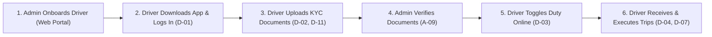

# HireD Driver Mobile Application — System & Feature Overview
*(Project Master Index & Architecture Overview)*

This document provides a single high-level overview of the **HireD Driver Mobile Application** features developed so far. It summarizes the user journey, core architectural decisions, and links to the detailed feature documents.

---

## 1. System Context & Driver Lifecycle

HireD is a specialized **B2B Corporate Mobility & Chauffeur Logistics Platform**. Unlike gig-economy ride-hailing apps with open self-registration, HireD operates on a **curated, managed corporate model**:



1. **Admin Onboarding (PRD A-07, A-09):** Admin creates the driver profile in the Admin Portal using the driver's phone number and credentials.
2. **Driver Login (PRD D-01):** Driver logs in using their registered 10-digit phone number.
3. **Mandatory KYC Upload (PRD D-02):** Driver uploads 4 mandatory documents (DL, Aadhaar, PAN, PCC) with 6 total sides.
4. **Admin Verification (PRD A-09):** Admin reviews documents from the portal queue and marks the account `ACTIVE`.
5. **Duty Availability (PRD D-03):** Driver starts as `Offline` by default upon download. When ready, toggles to `Now Online`, which persists across app restarts.
6. **Trip Execution (PRD D-04):** Driver receives corporate assigned trips.

---

## 2. Feature & Page Documentation Index

| Screen Index | Feature Name | PRD Requirements | Implementation Status | Detailed Documentation |
| :--- | :--- | :---: | :---: | :--- |
| **Page 1** | **Driver Login** | `D-01` | `[✓ Passed]` | [01_login.md](01_login.md) |
| **Page 2 & 3** | **Onboarding & KYC Documents** | `D-02`, `D-11`, `A-09` | `[✓ Passed]` | [02_documents_kyc.md](02_documents_kyc.md) |
| **Page 4** | **Home Dashboard & Duty Status** | `D-03`, `D-04` | `[✓ Passed]` | [03_home_dashboard.md](03_home_dashboard.md) |
| **Page 12** | **Driver Profile & Operations** | `D-12`, `D-02` | `[✓ Passed]` | [04_profile.md](04_profile.md) |
| **Reference** | **Backend API Integration & Route Status** | `D-01`–`D-12` | `[✓ Connected]` | [05_api_integration.md](05_api_integration.md) |
| **Reference** | **Field Mapping Audit (API ↔ DB ↔ Dart)** | All | `[✓ Audited]` | [06_field_mapping.md](06_field_mapping.md) |

---

## 3. Technology Stack & Key Decisions

* **Framework:** Flutter 3.x (Dart 3.x) targeting Android API 35 (Android 15) and iOS.
* **State Management:** Flutter Riverpod (`StateNotifierProvider`, `NotifierProvider`) for immutable, reactive unidirectional data flow.
* **Navigation:** `go_router` with declarative session redirection (`AuthRouterListenable`) and active route preservation across Android OS activity recreations.
* **Storage & Caching:**
  * `flutter_secure_storage`: Hardware-backed AES encrypted token storage (access tokens & refresh tokens).
  * `shared_preferences`: Fast synchronous-like profile caching (`LocalCacheService`), document serialization (`cached_driver_documents`), and duty persistence (`driver_duty_status_${driverId}`).
* **Design System & Theme:**
  * Custom `AppThemeColors` supporting dynamic Light & Dark themes with unified corporate purple (`#6A379F`).
  * Driver-first ergonomic touch targets (minimum 48–52dp) designed for one-hand in-vehicle operation.

---

## 4. Current State: UI with Local State Layer

> [!NOTE]
> All current screens operate in **UI + Local Simulation mode**:
> - Real local camera and file picking, local disk storage, input validations, and error handling are live and fully functional.
> - Backend integration is decoupled via `MockAuthRepository` and local Riverpod controllers until live REST endpoints are hooked up.
> - Data persistence works on-device using `SharedPreferences`, ensuring zero data loss when closing or killing the app.

---

## 5. Verification & Quality Summary

* **Static Analysis:** `flutter analyze` runs with **0 issues, 0 warnings**.
* **Physical Device Testing:** Tested and verified on live physical Android 15 device (`10BDAY0Y1D000DT`).
* **Test Matrix:** 100% of planned test scenarios for Pages 1, 2, 3, 4, and 12 are documented and passed in `TestCase/tdd_driver_app_scenarios.md`.

---

## 6. How to Run the Project

Navigate to the driver mobile app directory and run:

```bash
cd Trinity-X/driver-app

# 1. Check dependencies and static analysis (0 errors, 0 warnings)
flutter analyze

# 2. Run on connected Android device
flutter run -d <device_id>
# Example: flutter run -d 10BDAY0Y1D000DT

# 3. Run on desktop Linux or Chrome web-server preview
flutter run -d linux
flutter run -d web-server --web-port=8080
```
