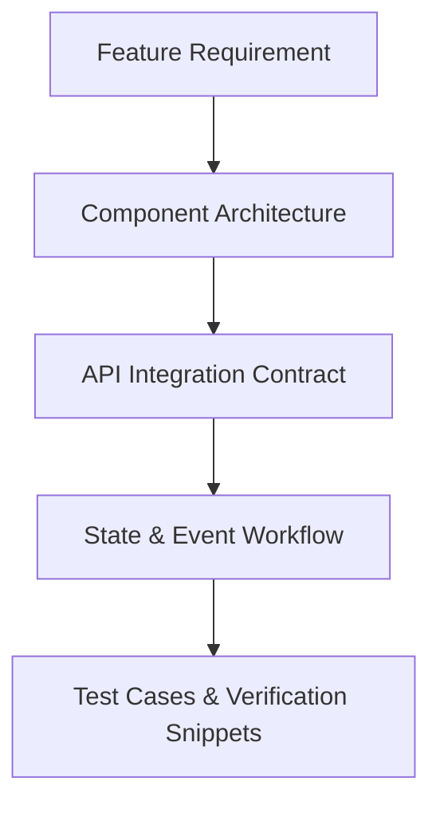

# Feature Documentation & Test Cases Directory (`testcases/docs/`)

Welcome to the central feature documentation and test cases repository for the **HireD Admin Portal**.

---

## 📌 Documentation Philosophy

Every feature in the Admin Portal maintains its own dedicated documentation file inside this directory, adhering strictly to the following core principles:

1. **Write for Humans First:** Plain, active voice, present tense, and jargon-free explanations.
2. **Prevent Duplication (DRY):** Each feature document serves as the single source of truth for its domain logic, state management, and API contracts.
3. **Incorporate Visual Aids:** Complex workflows and data interactions are modeled using standard Mermaid diagrams.
4. **Provide Real Code Examples:** Every feature document includes working, testable React/JavaScript code snippets, unit test examples, and sample API payloads.

---

## 📂 Feature Documentation Structure

```text
testcases/docs/
├── README.md                          # Documentation overview & style guide
├── 01_admin_authentication.md         # Admin login & session management
├── 02_admin_dashboard.md              # Key metrics dashboard & navigation
├── 03_admin_management.md             # Admin user directory & account creation
├── 04_orders_inbox.md                 # Orders inbox list & filtering
├── 05_create_order.md                 # Manual order creation for phone/WhatsApp
├── 06_order_details_and_decision.md   # Accept/reject order workflow & trip creation
├── 07_trips_and_driver_assignment.md  # Driver assignment, re-assignment & trip amount edits
├── 08_ongoing_trips_monitoring.md     # In-progress trips & live driver location tracking
├── 09_trip_reports.md                 # Trip financial reports & breakdowns
├── 10_driver_onboarding_queue.md      # Driver registration applications & document review
├── 11_driver_directory.md             # Driver profiles, availability calendar & status
├── 12_company_management.md           # B2B partner company directory & profile view
├── 13_company_onboarding_and_splits.md # Onboard B2B partner & set mandatory payout split
├── 14_payroll_settings.md             # Company payout split management & historical lock
├── 15_month_end_invoicing.md          # Statement consolidation & Two-Person Verification
└── 16_reports_dashboard.md            # System-wide analytics & operational reports
```

---

## 🎨 Diagram Standard Example



---

*This directory is updated incrementally alongside each feature branch development.*
